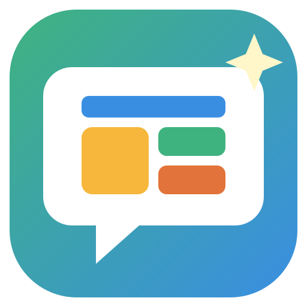

<div align="center">



# Build With Me at Home

**A fully local Claude Code plugin for parents: your kids plan and build their own small apps with a friendly AI guide, on your computer and your own Claude account, with you supervising.**

🏠 **Nothing is ever sent to the developer** of this plugin: no accounts, no sign-ups, no analytics, no tracking.

    

</div>

> [!NOTE]
> **Fully local.** The app, your kids' profiles, their conversations, their apps and your reports all live on your computer. The only thing that leaves it is the kids' chat with Claude, which goes to Anthropic through *your own* Claude Code, exactly like your own Claude use. Talking is turned into text on this computer too. Details in [Privacy](#privacy).

> [!IMPORTANT]
> **You're responsible for how your kids use this.**
> Build With Me runs on *your* Claude account.
>
> **Anthropic's terms say Claude users must be 18 or older, so letting your kids use it is your decision.**
>
> They can only use it with a pass you give them, for as long as you choose. You'll get a report after every app they make. The safety check and reports help you supervise; they don't replace you. Stay nearby, especially with younger kids.

## 📑 Contents

| Getting started | Using it | Peace of mind |
|---|---|---|
| [✨ What a kid does](#what-a-kid-does) | [📅 Every day](#every-day) · [🪟 Keep the window open](#stopping) | [🛡️ How kids are kept safe](#safety) |
| [🧰 What you need](#what-you-need) | [📱 Tablets and phones](#tablets) | [📄 The parent report](#report) |
| [⬇️ Install](#install) | [🔑 Forgot your PIN](#forgot-pin) | [🔒 Privacy](#privacy) |
| | [🔄 Updating](#updating) · [🗑️ Uninstalling](#uninstalling) | [⚡ Your Claude plan](#plan-usage) |
| | | [🛠️ For developers](#developers) · [📜 License](#license) |

---

<a id="what-a-kid-does"></a>
## ✨ What a kid does

1. 🎟️ **You give a pass** on your laptop: a QR code for a tablet, or "Open on this laptop".
2. 🎨 **They pick a look**, then talk or type with the guide through six steps: **👋 Start → 💡 Idea → 🎨 Design → 🛠️ Tech plan → 🏗️ Build → 🎉 Ship**.
3. 💡 **Stuck?** "Show me ideas" offers ideas from a built-in list of 128, or ideas for whatever the guide just asked.
4. 🏗️ **Claude builds the app** while they watch their own plan turn into code, then they ask for changes until they love it.
5. 🎉 **It goes on their *My apps* shelf**, with its own icon.
6. 📄 **You get a report**: what they made, whose ideas they were, anything worth a chat, and how much of your plan it used.

Kids (under 13) get short questions and picture cards. Teens (13–17) see and approve the plans.

---

<a id="what-you-need"></a>
## 🧰 What you need

- 🎫 **A paid Claude membership that includes Claude Code**, such as Claude Pro or Max, in your own name (you, the parent, are the account holder; Anthropic requires 18+). Build With Me uses your plan's limits: there's nothing extra to buy, and no API key. With a subscription, the Parent area also shows your 5-hour and weekly limits.
- 💻 **Windows or Mac.** Built and tested on Windows 11; the Mac steps are the same but less tested.
- 🤖 **The Claude Code command-line tool (`claude`)**, signed in to that membership. The Code tab in the Claude desktop app isn't enough on its own; setup offers Anthropic's official installer if `claude` is missing.
- 🟩 **Node.js 22 or newer.** Setup offers to install it if it's missing.
- 📶 For tablets: the tablet and the laptop on the same home Wi-Fi.

---

<a id="install"></a>
## ⬇️ Install

**1.** In Claude Code, run these two commands:

```
/plugin marketplace add https://github.com/paveliko123/build-with-me-at-home.git
/plugin install build-with-me@build-with-me-home
```

> [!TIP]
> Use the full `https://` address. The short `paveliko123/build-with-me-at-home` form needs GitHub SSH keys, which most computers don't have. While it starts up or sets up, Claude Code runs the plugin's own `node` scripts without asking each time; installing anything else (Node.js, Claude Code) still asks you first.

**2.** Start it:

```
/build-with-me:start
```

**3.** The first time, Claude Code checks everything and fixes what it can, asking you before it installs anything:

- 🔐 if `claude` isn't signed in, it asks you to run `claude`, type `/login` and finish in the browser (Build With Me never sees your password or tokens);
- 📦 it installs the app's packages (about a minute);
- 🎤 it downloads the speech-to-text model (about 250 MB, once), so talking works on this computer.

**4.** Your browser opens Build With Me. Create a parent PIN and add your kids (a nickname, Kid or Teen, and an emoji). A **Build With Me** shortcut appears on your desktop: from now on, just double-click it.

**5.** Keep the Build With Me window open while your kids use it: closing it stops the app. See [🪟 Keep the window open](#stopping).

> [!NOTE]
> On Windows, a firewall window may ask about Node.js. Choose **Private networks** so tablets at home can connect.

<details>
<summary><b>🔍 Optional: have your own Claude check it before you install</b></summary>

<br>

Nothing in this plugin runs until you type `/build-with-me:start`, so you can have your own Claude read the code first and tell you, in plain words, whether anything looks wrong. Open Claude Code in an empty folder and paste this (it uses a little of your plan):

```
Clone https://github.com/paveliko123/build-with-me-at-home.git into a new folder and review it
as a careful parent would before installing it as a Claude Code plugin. Only read the code:
don't run any of it, don't run npm install, don't start it.

Tell me, in plain words:
1. Does it send any data anywhere other than Anthropic through my own Claude Code
   (analytics, tracking, crash reports, hidden network calls, the developer's servers)?
2. Does it read or touch my files, my Claude settings or memory, passwords, tokens or API keys?
3. Does anything run by itself (at install, at startup, in the background) without me asking?
4. What does it change on my computer, and does each change match what the README says?
5. Is anything hidden, obfuscated, or different from what the README promises?

Good to know: it does a few things on purpose, described in its README, so judge whether
each matches the README and is reasonable: it creates a home certificate so tablets can use
the microphone, listens on home-network ports 4747 and 4748, adds a desktop shortcut, keeps
its data in a "Build With Me" folder in my home folder, and runs my own `claude` command for
the kids' sessions. app/dist is the built (minified) version of server/ and web/; review the
source and spot-check app/dist/server/main.mjs for network calls.

End with a short verdict (looks safe / some concerns / don't install) and anything I should check.
```

Questions or concerns? See [SECURITY.md](SECURITY.md).

</details>

---

<a id="every-day"></a>
## 📅 Every day

1. 🖱️ Double-click **Build With Me** on the desktop (or run `/build-with-me:start` in Claude Code) and enter your PIN.
2. 🎟️ Under **Give a pass**, pick the kid and how long, then **Create pass**.
3. 📲 The kid scans the QR code with a tablet, or you tap **Open on this laptop**. One device per pass; you can extend or end it from your laptop at any time.
<a id="stopping"></a>

> [!IMPORTANT]
> **🪟 Keep the Build With Me window open while your kids use it.** It runs only while its window (the PIN page or the Parent area) is open on your laptop. Closing Claude Code doesn't matter; closing that window does.
>
> **When you close it,** Build With Me stops about a minute later, for kids on tablets too: they see a countdown ("It will stop in 45 seconds. Everything is saved."), and if you reopen it in time, nothing stops. A reload doesn't count as closing, a build or report in progress finishes first, and the minute only counts while the laptop is awake.
>
> **To start it again:** double-click **Build With Me** on the desktop. Close the window when you're done, and always before using a public Wi-Fi (a café, a hotel).

---

<a id="tablets"></a>
## 📱 Tablets and phones

Talking from a tablet needs a secure connection, so each tablet is set up once: in the Parent area, open **Kids & their apps → 📱 Set up a tablet or laptop for talking** and follow the steps on the tablet. It installs a certificate that only works on your home network. Setup only works while that window is open on your laptop, and the window shows the certificate's fingerprint: before you trust the certificate on the tablet, check that they match. Typing works without it.

---

<a id="forgot-pin"></a>
## 🔑 Forgot your PIN

In Claude Code: `/build-with-me:reset-pin`. It also clears a PIN-pad lockout (wrong PINs lock it for longer each time) and locks any Parent area that's still open. After you unlock, the Parent area tells you if someone typed wrong PINs.

---

<a id="updating"></a>
## 🔄 Updating

In a terminal:

```
claude plugin marketplace update build-with-me-home
claude plugin update build-with-me@build-with-me-home
```

The next start picks up the new version by itself (the first start after an update takes about a minute longer). Your kids, their apps, the reports and your PIN are kept.

---

<a id="uninstalling"></a>
## 🗑️ Uninstalling

In a terminal:

```
claude plugin uninstall build-with-me@build-with-me-home
```

This removes the app. Your family's folder (see [Privacy](#privacy)) stays, so nothing your kids made is lost by accident. To remove everything:

1. 🗑️ Delete the family folder (`C:\Users\<you>\Build With Me` or `~/Build With Me`). It includes the kids' work, the reports and the home certificate for tablets (in the hidden `.home-certificate` folder inside it).
2. 📱 On each tablet you set up for talking, remove the certificate named **Build With Me Home (…)** from its security settings.
3. 🖱️ Delete the **Build With Me** shortcut on the desktop.

---

<a id="safety"></a>
## 🛡️ How kids are kept safe

Several layers work together. None of them is perfect on its own, which is why you stay nearby and get a report.

| | Layer | What it does |
|---|---|---|
| 🎟️ | **Only with your pass** | The Parent area opens only on your laptop, behind your PIN, and locks itself after 15 idle minutes or when its window closes. Wrong PINs lock the PIN pad for longer each time. Kids need a timed pass from you, it works on one device, and you can end it any time. Each pass is capped (10 requests a minute, 150 an hour, 5 new apps, 30 builds). |
| 🧭 | **A guide made for kids** | The guide says it's an AI, not a person. It follows strict safety rules in every message, adjusts to the kid's age group, never asks for personal details, and redirects kindly instead of scolding. |
| 🔍 | **Everything checked, both ways** | A separate Claude safety check reads **what the kid says** (before the guide's answer is shown), **everything the guide is about to show** (its words, pictures, plans and build steps), the change list, the app's name, and **every word the finished app can show**, checked last, exactly as it's saved. |
| 🙈 | **Personal details hidden** | Obvious details (a full name, home address, school, phone number or email) are masked the moment they're typed or said, before anything is saved or sent; the safety check catches ones the masking missed. |
| 🧱 | **Apps sealed off** | Kids' apps run in a locked-down frame: they can't load anything from the internet, send anything out or open a website, can't ask for passwords or payments, and can't reach the rest of your computer. |
| 🔐 | **Your Claude kept separate** | The kids' Claude sessions run sealed off from your own Claude Code, with no tools at all: they can't see your settings, memory, projects or files. (Hiding your account name or email from what Claude says is best-effort, on top of that.) |

**What happens when the check finds something:**

| The check finds… | The kid sees | You see |
|---|---|---|
| 🚫 **Something unsuitable** (violence, weapons, adult or scary themes, drugs, hate or bullying, scams, tricks to break the rules) | A kind "let's make something else instead!" It's never answered and never built. | A flag in the report |
| 🙈 **A personal detail** | The detail is hidden, and the guide gently says it isn't needed here. | A flag in the report |
| 💛 **A sign they may be hurting or unsafe** | A warm message to tell a trusted grown-up right away, and to call the local emergency number if they're in danger. | 💛 **An alert at once**, with a chime: on your home screen and on the PIN page, so a locked Parent area can't hide it. Then 🔴 **Needs a look** in the report. |

Reports are written when the kid ships the app, leaves it with **＋ New app**, or the pass ends; a wellbeing alert doesn't wait for that.

Cartoon battles, silly monsters, superheroes, space lasers and everyday "I'm bored" are fine: the check is built to be fair to kids, not jumpy.

If the safety check itself can't run (say, a network hiccup) or its answer can't be read, nothing goes through unchecked: the message is held back, your kid is asked to try again, and your report notes it. If your kid's words in that moment may mean they're hurting, you're still alerted.

What kids type **inside** their finished apps (a diary entry, a pet's name in a game) stays in the app on that device: it isn't checked or reported.

---

<a id="report"></a>
## 📄 The parent report

After every app (or when a pass ends before the app is finished), Claude Opus reads the whole conversation and writes you a report. If a pass ends while Build With Me isn't running, the report is written the next time you start it. It's in the Parent area (**Latest reports**, **All reports**) and saved as a file in your family folder's `Reports` folder.

**The safety level** sits at the top of every report:

| Level | Means |
|---|---|
| 🟢 **No flags** | Nothing came up. |
| 🟡 **Flags, handled by the guide** | Something came up (say, a personal detail or an unsuitable idea) and the guide dealt with it; the kid moved on. |
| 🔴 **Needs a look** | Something a parent should see soon: a sign the kid may be hurting or unsafe, anything unsuitable coming from the guide or an app, or anything the reviewer thinks needs your attention. It also shows under **Needs your attention** on your home screen. |

**Also in every report:**

- 📊 **The facts:** time spent, rounds of changes, the device, talking or typing, and the app's share of your 5-hour limit.
- 📝 **In one paragraph:** what happened.
- 🎮 **The app** itself, with a link to open it.
- ⚠️ **Each flag:** what was said and who said it (your kid, the guide or the app), what the guide did, and how your kid reacted.
- ✅ **Three checks:** were personal details shared, did the guide or an app say anything unsuitable (these two come straight from the automatic checks, so nothing typed in the chat can change them), and did the session stay on the project.
- 💬 **Worth a chat?** anything to talk about together.
- 💡 **Whose ideas?** your kid's share versus the guide's, whether they started from the idea list, and the ideas they had while waiting.
- 🕒 **How it went:** a timeline of the six steps.
- 🗣️ **Talk about it together:** conversation starters, and the full conversation (personal details hidden).

---

<a id="privacy"></a>
## 🔒 Privacy: what's stored and what leaves your computer

- 🏠 **Everything is stored on your computer**, in your family's folder: `C:\Users\<you>\Build With Me` on Windows, `~/Build With Me` on a Mac. It holds the kids' profiles, their conversations and plans, their apps and the reports, plus the home certificate for tablets (a hidden `.home-certificate` folder, kept here so tablets keep working after updates) and a few small files the desktop shortcut uses. Build With Me refuses to use a cloud-synced folder (like OneDrive) for it.
- 🧩 **App files** (the program, its packages, the speech model, a log) live in Claude Code's plugin data folder.
- 📤 **What leaves your computer:** the kids' conversations and plans go to Anthropic through *your* Claude Code, the same way your own Claude Code use does, to run the guide, build the apps, check safety and write your reports. Nothing else is sent anywhere, and **nothing at all is sent to the developer of this plugin**: no accounts, no analytics, no tracking, no crash reports.
- 📥 **Downloads:** the app's packages (from npm) and the speech model (from Hugging Face), once each, during setup (the model also at the first start, if setup skipped it). Nothing about you or your kids is sent with them.
- 🎤 **Talking stays local:** speech-to-text runs on this computer; the guide's voice is your device's built-in voice.
- 📶 **Your network:** other devices can reach Build With Me only while a pass is live or tablet setup is open on your laptop; otherwise they see a "resting" page and nothing else. Even then, kids' devices reach the kid side only, with a pass, and the Parent area only opens on the laptop itself. On a public Wi-Fi (a café, a hotel), close the Build With Me window first: the app stops about a minute later.
- 🗑️ **Deleting:** removing a kid in **Kids & their apps** deletes all of their data (conversations, apps, reports and passes) after a warning. Nothing is deleted automatically otherwise.

---

<a id="plan-usage"></a>
## ⚡ Your Claude plan

Build With Me uses your Claude Code plan. A typical app takes a few percent of the 5-hour limit (each report shows that app's share). The per-pass caps mean one pass can't use up your plan, and the Parent area shows your 5-hour and weekly limits.

Besides the kids' own chats and builds, it makes a few small calls on its own: the safety checks, a quick reading of your plan's usage (when an app starts and finishes, and when the Parent area shows your limits), the sign-in check during setup, and the Opus report after each app.

---

<a id="developers"></a>
## 🛠️ For developers

```bash
npm install
npm run dev:server    # the server on :4747
npm run dev:web       # the front end with hot reload (in a second terminal)
```

- ✅ `npm run typecheck`, and the checks that make no Claude calls: `npm run verify:revisions`, `npm run verify:security`, `npm run test:guard`.
- 📦 `npm run release` type-checks, runs those checks, builds the front end and the server into `app/dist/` and scans it for private data. `app/dist/` is committed, so families never need a build step.
- 🔌 Try the plugin from this folder with `claude --plugin-dir .`.
- 📚 The planning documents (scope, product requirements, technical spec, build checklist, security audit) are in `devpost/`; the `.html` files are the easiest to read.

---

<a id="license"></a>
## 📜 Credits and license

MIT License; see [LICENSE](LICENSE). The guide's stage instructions are the Devpost Learn "Build With AI: Basics" course skills, used under their own MIT License (Copyright (c) 2026 Devpost); see [app/skills](app/skills).

🔐 Security issues: see [SECURITY.md](SECURITY.md).
